# Struktur Database KP Monitor

Dokumen ini menjelaskan struktur database (MySQL, nama database `kp_monitor`).
Diagram di bawah memakai Mermaid: buka dengan Markdown Preview di VS Code atau Antigravity.

## Prinsip

- Semua relasi memakai foreign key. Data penting memakai soft delete (`deleted_at`), jadi tidak ada data KP yang hilang permanen.
- Aturan bisnis dijaga di database dengan constraint unik, bukan hanya di kode.
- Pengaturan yang bisa berubah (skala nilai) disimpan di tabel, bukan di kode.
- Riwayat disimpan terpisah (status penempatan, status konversi, versi skala nilai).
- Nama tabel memakai bahasa Inggris. Tampilan aplikasi memakai bahasa Indonesia.

## Aturan bisnis yang dijaga struktur

| Aturan | Cara dijaga |
|---|---|
| Satu mahasiswa hanya punya satu penempatan aktif | `internships.active_student_id` unik; terisi hanya saat status `diajukan` atau `berjalan` |
| Satu meeting per penempatan per minggu | unik `weekly_meetings(internship_id, week_number)` |
| Company Supervisor tidak ganda pada satu penempatan | unik `internship_staff(internship_id, user_id, role)` |
| Akses Company Supervisor per penempatan | tabel `internship_staff` (role `supervisor`) |
| Nomor task (kode seperti ORD-12) tidak kembar | unik `weekly_tasks(internship_id, number)` |
| Kode proyek tidak kembar dalam satu penempatan | unik `projects(internship_id, key)` |
| KP selesai: data hanya bisa dibaca | `internships.locked_at` terisi otomatis; task dan bukti ditolak |
| Huruf mutu terkunci permanen | `assessments.letter_grade` + `grade_scale_version`; penilaian tervalidasi tidak bisa diubah |
| Perubahan skala tidak mengubah nilai lama | `grade_scales` berversi; nilai menyimpan versi yang dipakai |
| Satu penilaian akhir per penempatan | unik `assessments(internship_id)` |
| Satu sertifikat per penempatan, nomor unik | unik `certificates(internship_id)`, `number`, `verification_token` |
| Satu langkah persetujuan per tahap | unik `internship_approvals(internship_id, step)` |
| Task berada di bawah rencana kegiatan | `weekly_tasks.activity_plan_id` wajib saat task dibuat (dijaga di `SaveTaskRequest`) |
| Rentang rencana di dalam periode KP | `activity_plans.start_date/end_date` divalidasi terhadap `internships.start_date/end_date` |
| Nilai penilaian lama tidak berubah | `assessments.category_weights` menyimpan bobot saat dikirim; pertanyaan yang sudah dipakai diubah sebagai rubrik versi baru |
| NIM dan NIDN tidak boleh kembar | unik `users.nim`, `lecturer_profiles.nidn` |

## Diagram relasi

```mermaid
erDiagram
    users ||--o| student_profiles : punya
    users ||--o| lecturer_profiles : punya
    users ||--o| company_staff_profiles : punya
    users ||--o{ student_skills : menguasai
    skills ||--o{ student_skills : dikuasai
    study_programs ||--o{ student_profiles : berisi
    study_programs ||--o{ lecturer_profiles : berisi

    companies ||--o{ company_divisions : memiliki
    companies ||--o{ company_staff_profiles : mempekerjakan
    companies ||--o{ job_postings : membuka
    job_postings }o--o{ skills : membutuhkan
    companies ||--o{ invitations : mengundang

    users ||--o{ internships : "mahasiswa"
    companies ||--o{ internships : menerima
    company_divisions ||--o{ internships : menempatkan
    academic_periods ||--o{ internships : mencakup
    internships ||--o{ internship_staff : "Company Supervisor"
    users ||--o{ internship_staff : bertugas
    internships ||--o{ internship_approvals : disetujui
    internships ||--o{ internship_status_histories : riwayat
    internships ||--o{ invitations : untuk

    internships ||--o{ activity_plans : merencanakan
    internships ||--o{ goals : menargetkan
    activity_plans ||--o{ weekly_tasks : "berisi task"
    goals ||--o{ weekly_tasks : dikaitkan
    internships ||--o{ weekly_tasks : memuat
    internships ||--o{ weekly_meetings : menjadwalkan
    weekly_tasks ||--o{ task_evidences : bukti
    weekly_tasks ||--o{ task_comments : komentar
    files ||--o{ task_evidences : berkas
    users ||--o{ task_templates : memiliki
    task_templates ||--o{ task_template_items : berisi

    assessment_rubrics ||--o{ rubric_aspects : terdiri
    assessment_rubrics ||--o{ assessments : dipakai
    internships ||--o| assessments : dinilai
    assessments ||--o{ assessment_scores : skor
    rubric_aspects ||--o{ assessment_scores : aspek
    internships ||--o| defense_scores : sidang

    internships ||--o| conversion_candidates : direkomendasikan
    conversion_candidates ||--o{ conversion_histories : riwayat

    document_folders ||--o{ document_folders : subfolder
    document_folders ||--o{ documents : berisi
    files ||--o{ documents : berkas
    users ||--o{ letter_requests : mengajukan
    certificate_templates ||--o{ certificates : dipakai
    internships ||--o| certificates : diterbitkan

    users ||--o{ activity_logs : melakukan
```

## Kamus data

### 1. Akun dan akses

| Tabel | Isi | Kolom penting |
|---|---|---|
| `users` | Semua akun | `role` (mahasiswa, supervisor, dospem, kaprodi, tu, admin; biro dihapus di v3 dan diubah jadi admin), `nim` unik, `is_active`, `last_login_at`, soft delete |
| `student_profiles` | Profil mahasiswa | `study_program_id`, `entry_year` (angkatan), `gpa` |
| `lecturer_profiles` | Profil dosen, kaprodi | `nidn` unik, `study_program_id` |
| `company_staff_profiles` | Profil Company Supervisor | `company_id`, `division_id`, `job_title` |
| `invitations` | Undangan aktivasi Company Supervisor (diterbitkan TU Fakultas) | `token` unik, `role`, `expires_at`, `accepted_at` |

### 2. Data master

| Tabel | Isi | Kolom penting |
|---|---|---|
| `study_programs` | Program studi | `code` unik |
| `academic_periods` | Periode akademik | `is_active` |
| `skills` | Daftar skill | `name` unik, `category` |
| `student_skills` | Skill tiap mahasiswa (banyak per mahasiswa) | unik (`user_id`, `skill_id`), `level` |
| `companies` | Perusahaan mitra dan KP mandiri | `industry` (pilihan: Pendidikan, Keuangan, Teknologi dan IT, Industri / Manufaktur, Perdagangan, atau isian "Lainnya"), `website` opsional, `status` (mitra, mandiri_menunggu, mandiri_terverifikasi), `verified_by` (TU Fakultas) |
| `company_divisions` | Divisi per perusahaan | unik (`company_id`, `name`) |
| `settings` | Pengaturan sistem | `key` unik, `value` (JSON); antara lain `simagti.assessment.weights` (bobot kategori, kaprodi) dan `simagti.assessment.scale` (skala nilai, admin) |
| `files` | Metadata semua berkas | `disk`, `path`, `mime_type`, `size`, `checksum` |

### 3. Penempatan dan persetujuan

| Tabel | Isi | Kolom penting |
|---|---|---|
| `internships` | Satu baris = satu KP (pusat semua fitur) | `track` (lowongan, mandiri), `position`, `supervisor_name/title/email/phone` (dari formulir mahasiswa), `cadence` (daily, weekly, monthly), `status`, `active_student_id` unik, `locked_at`. Sejak v3 satu jenis KP: kolom `program`, `program_type`, `topic`, `organizer`, `syllabus_*` dihapus |
| `internship_staff` | Company Supervisor per penempatan | `role` (supervisor) |
| `internship_approvals` | Persetujuan KP mandiri | `step` (tu_verification, kaprodi_approval), `status` (pending, approved, rejected) |
| `internship_status_histories` | Riwayat perubahan status | `from_status`, `to_status`, `changed_by` |

### 4. Lowongan

| Tabel | Isi |
|---|---|
| `job_postings` | Pengumuman lowongan (`status`: draft, published, closed; `deadline`, `quota`) |
| `job_posting_skill` | Skill yang dibutuhkan lowongan |

### 5. Rencana kegiatan, goals, kegiatan, dan timesheet

| Tabel | Isi | Kolom penting |
|---|---|---|
| `activity_plans` | Rencana kegiatan di Timesheet (tampil sebagai Gantt), diisi sebelum task | `title`, `description`, `start_date`, `end_date` (di dalam periode KP), `goal_id`, `position` |
| `goals` | Goals mahasiswa di halaman Kegiatan | `title`, `description`, `achieved_at`, `position` |
| `projects` | Proyek di board mahasiswa | `name`, `key` (kode task), `color`, `archived_at` |
| `board_columns` | Kolom board (bebas diatur mahasiswa; bawaan To Do, In Progress, Done) | `name`, `category` (todo, in_progress, done), `position` |
| `weekly_tasks` | Task yang dibuat mahasiswa (nama tabel dari versi awal) | `number`, `activity_plan_id`, `goal_id`, `project_id`, `board_column_id`, `priority`, `start_date`, `due_date`, `labels`, `status` (dari kolom), `week_number` (dari tenggat) |
| `task_checklist_items` | Checklist per task | `text`, `is_done`, `position` |
| `time_entries` | Catatan kegiatan harian (tanpa durasi jam sejak v3) | `work_date`, `description`, `weekly_task_id`, `file_id` (foto) |
| `task_evidences` | Bukti pengerjaan (banyak per task) | `type` (link, file), `url`, `file_id` |
| `task_comments` | Percakapan komentar per task | `user_id`, `body` |
| `weekly_meetings` | Jadwal meeting mingguan | `day`, `time`, `url`; unik per penempatan per minggu |
| `task_templates`, `task_template_items` | Template task yang bisa disalin ke board | `is_shared`, `week_number`, `day` |
| `task_attachments` | Lampiran materi lama (versi awal), hanya bisa dibuka | `file_id` |

### 6. Penilaian

| Tabel | Isi | Kolom penting |
|---|---|---|
| `grade_scales` | Skala huruf berversi (standar kampus: A 80, B+ 74, B 68, C+ 62, C 56, D 45, E 0; diatur admin) | unik (`version`, `grade`), `min_score` |
| `assessment_rubrics`, `rubric_aspects` | Standar penilaian kampus: pertanyaan per kategori (diatur admin) | `rubric_aspects.category` (hard, soft, attitude), `name`; rubrik aktif = `is_active` |
| `assessments` | Penilaian akhir Company Supervisor di akhir periode KP (dibuka 14 hari sebelum KP berakhir) | `status` (draft, submitted, validated), `final_score`, `letter_grade`, `grade_scale_version`, `category_weights` (json), `comment` |
| `assessment_scores` | Nilai skala yang diklik per pertanyaan | unik (`assessment_id`, `rubric_aspect_id`), `score` |

Nilai kategori = rata-rata nilai pertanyaannya. Nilai akhir = jumlah (nilai kategori × bobot kategori / 100), bobot diatur kaprodi (bawaan 35/35/30).
| `defense_scores` | Nilai sidang dari kaprodi | `score`, `letter_grade`, `defended_at` |

### 6b. Tahap 2 (yang masih dipakai)

Dihapus di v3: `syllabus_items`, `monthly_reviews`, `credit_recognitions`, kuesioner milik dosen (`assessment_rubrics.owner_id`), dokumen pakta integritas.

| Tabel / kolom | Isi | Kolom penting |
|---|---|---|
| `internships` (tambahan) | Konfirmasi supervisor, hasil akhir | `supervisor_confirmation` (confirmed, disputed), `supervisor_confirmation_note`, `supervisor_confirmed_at`, `result` (diterima, tidak), `result_note`, `final_score`, `final_grade` (dari penilaian tervalidasi), `result_by`, `result_at`; status `dibatalkan`, `pindah` |
| `guidance_sessions` | Log bimbingan dosen | `held_on`, `mode` (daring, luring), `topic`, `status` (pending, confirmed, rejected) |
| `internship_documents` | Surat pengantar dan surat balasan (diproses TU Fakultas) | unik (`internship_id`, `type`), `status` (diminta, terbit, menunggu, diunggah, diterima, ditolak), `number` unik, `file_id`, `due_on` |
| `change_requests` | Pengajuan perubahan | `type` (extend, transfer, withdraw, replace_supervisor), `status`, `step` (supervisor, kaprodi, tu), `payload` (json) |

### 7. Konversi karyawan

| Tabel | Isi |
|---|---|
| `conversion_candidates` | Status: direkomendasikan, ditawari, diterima, ditolak (satu per penempatan) |
| `conversion_histories` | Riwayat tiap perubahan status |

### 8. Dokumen dan sertifikat

| Tabel | Isi |
|---|---|
| `document_folders`, `documents` | Folder dan berkas template dari kaprodi (surat, laporan, pendukung) |
| `letter_requests` | Permintaan surat pengantar (`status`: diajukan, diproses, selesai, ditolak) |
| `certificate_templates` | Template sertifikat (`scope`: kampus atau perusahaan; logo, tanda tangan, stempel) |
| `certificates` | Sertifikat terbit: `number` unik, `verification_token` unik untuk QR, `status` (draft, terbit, dicabut) |

### 9. Sistem

| Tabel | Isi |
|---|---|
| `activity_logs` | Siapa melakukan apa dan kapan (`action`, `ip_address`, `properties`); sumber Log Aktivitas (admin) dan Activity monitor (supervisor, dosen, kaprodi) |
| `notifications` | Notifikasi standar Laravel |

## Seeder

- `MasterSeeder`: program studi, periode, skill, skala huruf mutu versi 1, standar penilaian 14 pertanyaan (4 hard skill, 4 soft skill, 6 attitude). Aman dijalankan di server sungguhan.
- `DataSeeder`: data realistis (fiktif) untuk demo dan pameran, akun di `docs/AKUN.md`.
- `DemoSeeder` (lewat `TestingSeeder`): data kecil untuk tes otomatis, akun `*@kp.test`. Jangan dijalankan di server sungguhan.
- `Concerns/SeedsStageTwo`: konfirmasi supervisor, bimbingan, dokumen, penilaian akhir, hasil, perubahan, dan notifikasi contoh (hasil tetap).
- `Concerns/SeedsActivities`: pengisi goals, rencana kegiatan, proyek, task, catatan kegiatan, bukti, komentar, dan log aktivitas 30 hari terakhir yang dipakai kedua seeder (hasilnya tetap, tidak acak).

Migrasi v3: `2026_10_27_100000_kp_v3_revisi.php`. Setelah menarik versi ini jalankan `php artisan migrate:fresh --seed` (data lama tidak dipertahankan karena struktur berubah besar).
